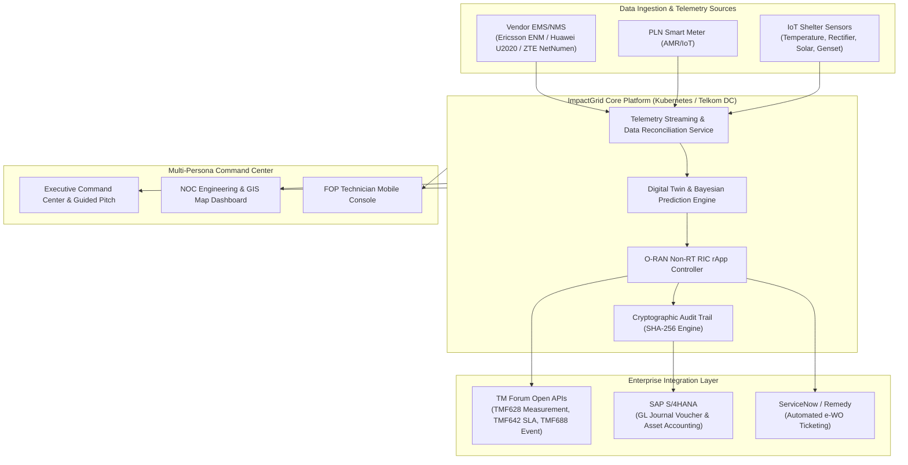
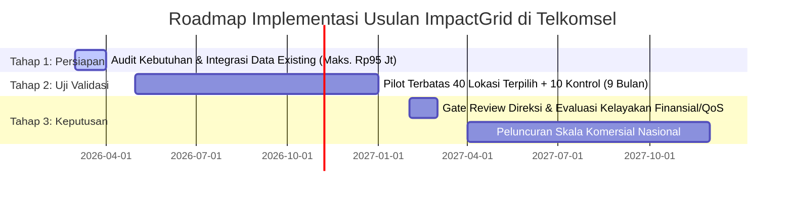

<p align="center">
  
</p>

<h1 align="center">ImpactGrid — Telkomsel RAN Energy Operations Suite</h1>
<p align="center">
  <strong>Autonomous Energy Operations & Decision Support System (DSS) for Next-Gen Sustainable Telecom Infrastructure</strong>
</p>

<p align="center">
  <a href="#-status-pengujian--kualitas"></a>
  <a href="#-status-pengujian--kualitas"></a>
  <a href="#-arsitektur--standar-industri"></a>
  <a href="#-arsitektur--standar-industri"></a>
  <a href="#-esg--audit-trail"></a>
  <a href="#-lisensi--repositori"></a>
</p>

---

## 📌 Ringkasan Eksekutif (Executive Summary)

**ImpactGrid** adalah platform **Decision Support System (DSS)** dan **Autonomous Energy Operations Suite** kelas *enterprise* yang dirancang khusus untuk memodernisasi efisiensi konsumsi daya jaringan akses radio (**Radio Access Network / RAN**) Telkomsel. 

Platform ini menjembatani jurang pemisah antara strategi efisiensi biaya (*OPEX reduction*), dekarbonisasi korporasi (*ESG Net Zero Emission*), serta ketahanan mutu layanan telekomunikasi (*QoS & Service Assurance*). Melalui pendekatan **O-RAN Non-RT RIC rApp**, ImpactGrid menyajikan simulasi *What-If* berbasis *Digital Twin*, orkestrasi *smart sleep mode* otomatis dengan *fail-safe kill switch*, rekonsiliasi penghematan sewa menara bersama (*TowerCo Shared Savings*), serta integrasi jurnal akuntansi **SAP S/4HANA (IFRS 16 / PSAK 73)**.

> 🔗 **Repository URL:** [https://github.com/irsyadazaki77-beep/impactgrid-prototype](https://github.com/irsyadazaki77-beep/impactgrid-prototype)

---

## 🌐 Realitas Operasional & Konteks Data Telkomsel

Merujuk pada publikasi resmi **Laporan Keberlanjutan PT Telkom Indonesia Tbk 2025** dan profil emisi di portal **GoZero**:

* ⚡ **Konsumsi Listrik Jaringan:** **1.885.417.875,2 kWh/tahun** (±1,88 Miliar kWh).
* 🏭 **Emisi GRK Scope 2:** **1.721.967,7 tCO₂e/tahun** (faktor emisi grid PLN nasional ~0,913 kg CO₂/kWh).
* 🗼 **Dominasi Beban Daya:** Lebih dari 70-80% konsumsi daya operasional telekomunikasi berpusat pada infrastruktur **Base Transceiver Station (BTS) / RAN**, khususnya modul Radio Unit (RU), Baseband Unit (BBU), dan sistem pendingin *shelter* (HVAC).
* 🎯 **Tantangan Utama:** Lonjakan trafik data eksponensial menuntut efisiensi konsumsi daya tanpa mengorbankan indikator performa kunci jaringan (*Call Drop Rate / CDR*, *Latency*, dan *Throughput*).

---

## ✨ Fitur Unggulan Platform (Key Modules)

```
┌─────────────────────────────────────────────────────────────────────────────────────────┐
│                                 IMPACTGRID PLATFORM                                      │
├──────────────────────────┬───────────────────────────┬──────────────────────────────────┤
│   EXECUTIVE STRATEGY     │    NOC & DEEP ENGINEERING │     SETTLEMENT & COMPLIANCE      │
├──────────────────────────┼───────────────────────────┼──────────────────────────────────┤
│ • Guided Pitch 7 Menit   │ • O-RAN Non-RT RIC Engine │ • SAP S/4HANA Accounting Voucher │
│ • Executive One-Pager    │ • Digital Twin Scenario   │ • BA-RE Legal Document Engine    │
│ • Executive Dossier A4   │ • National GIS Map (38 Pr)│ • TowerCo Shared-Savings Settle. │
│ • IAM Persona Switcher   │ • FOP Technician Console  │ • ESG GRI 302/305 Audit Trail    │
│ • Fail-Safe Drill 112    │ • Real-time Telemetry Inq │ • TM Forum Open API Compliance   │
└──────────────────────────┴───────────────────────────┴──────────────────────────────────┘
```

### 1. 🎯 Executive Command Center & 7-Minute Guided Pitch
* **Mode Presentasi Terpandu (Guided Pitch):** Memandu dewan direksi melalui 8 babak presentasi strategis dalam 7 menit (Masalah → Solusi → Rekonsiliasi → Prioritisasi → Validasi Pilot → Finansial → ESG → Keputusan). Dilengkapi *teleprompter notes*, navigasi *keyboard*, dan visual *cue*.
* **Executive Decision One-Pager:** Modal ringkasan keputusan 1 lembar komprehensif yang merangkum proposal audit 2 bulan (Rp95 Juta) vs risiko status quo.
* **Executive Dossier A4:** Ringkasan eksekutif siap cetak/PDF dengan tata letak korporat formal standar Telkomsel / Telkom Group.
* **IAM Multi-Persona Switcher:** Kemampuan beralih sudut pandang secara instan: *C-Level Executive, VP Network Operations, Lead RAN Engineer, ESG Specialist, FOP Field Technician,* dan *Finance Auditor*.

### 2. 🤖 O-RAN Autonomous Closed-Loop rApp Engine
* **Non-RT RIC Integration:** Rekomendasi kebijakan hemat daya otomatis dengan siklus adaptasi 10–15 menit berbasis model *traffic prediction*.
* **Zero-Downgrade SLA Guard:** Perlindungan instan terhadap degradasi trafik; otomatis membatalkan *carrier sleep* jika utilisasi sel melonjak melebihi 75%.
* **Emergency Fail-Safe 112 Drill:** *Kill-switch* darurat yang mampu mengembalikan seluruh sel BTS ke daya operasional 100% dalam waktu kurang dari 3 detik saat bencana atau panggilan darurat 112 terdeteksi.

### 3. 🧪 Digital Twin & Scenario Lab
* **Simulasi Multi-Teknologi:** Uji komparasi skenario *MIMO Deep Sleep, Micro-Sleep Tx, RF Channel Blanking, Smart Chiller Inverter HVAC,* hingga adopsi *Solar PV + Lithium Battery Storage*.
* **Confidence Interval 95%:** Proyeksi penghematan berbasis statistik Bayesian dan perbandingan *Pre vs Post* pada cluster pilot 40 lokasi vs 10 lokasi kontrol independen.

### 4. 🗺️ National GIS Geospatial Intelligence
* **Peta Interaktif 38 Provinsi:** Visualisasi spasial BTS Telkomsel di seluruh wilayah Indonesia (Sumatera, Jawa, Bali-Nusa, Kalimantan, Sulawesi, Maluku, Papua).
* **Per-Site Health & Telemetry Ingestion:** Filter dinamis berdasarkan vendor (Ericsson, Huawei, ZTE), tipe shelter (Rooftop, Greenfield, Microcell), dan status transmisi.

### 5. 🛠️ NOC & FOP Field Technician Console
* **Mobile Technician Console:** Tampilan mobile responsif untuk teknisi pemeliharaan lapangan (*Field Operations*).
* **QR Code Verifikasi Fisik Shelter:** Validasi kehadiran teknisi di lokasi BTS untuk audit sensor suhu, AC inverter, dan status recti PLN.
* **Auto e-WO Generator:** Pembuatan tiket kerja otomatis terhubung ke format ServiceNow / Remedy IT Service Management.

### 6. 💼 Financial Accounting & Legal Multi-TowerCo Settlement
* **SAP S/4HANA Accounting Journal Voucher:** Otomatisasi pembukuan pemindahbukuan akun GL (Beban Listrik BTS vs Biaya Jasa Efisiensi Energi) sesuai standar **IFRS 16 / PSAK 73**.
* **Legal Berita Acara Rekonsiliasi Energi (BA-RE):** Generator dokumen legal berstandar korporat berformat PDF/cetak dengan verifikasi kode unik SHA-256 untuk dasar penagihan *shared-savings* dengan TowerCo (Mitratel, Protelindo, Tower Bersama Group).
* **Dual-DC Chaos & Disaster Recovery Simulator:** Simulasi kegagalan infrastruktur data center (Telkom DC Serpong vs Surabaya Rungkut) dengan mekanisme *Active-Active failover*.

### 7. 🌿 ESG Compliance & Cryptographic Audit Trail
* **Pelaporan Terstandarisasi:** Metrik kepatuhan energi **GRI 302** (konsumsi energi dalam & luar organisasi) dan emisi **GRI 305** (Scope 1 BBM genset, Scope 2 listrik PLN).
* **Audit Trail SHA-256 Chain:** Setiap perubahan konfigurasi, log telemetri, dan rekomendasi model dicatat dengan *immutable hash* untuk verifikasi auditor eksternal.

---

## 🏗️ Arsitektur Sistem & Keselarasan Standar

ImpactGrid mengadopsi prinsip arsitektur terbuka yang mematuhi pedoman konsorsium telekomunikasi global:



* **O-RAN Alliance Non-RT RIC Architecture:** Mematuhi antarmuka A1 untuk transfer kebijakan kecerdasan buatan ke Near-RT RIC.
* **TM Forum Open Digital Architecture (ODA):** Kesiapan integrasi terhadap **TMF628** (Performance Management), **TMF642** (SLA Management), dan **TMF688** (Event Management).
* **Deployment Spec:** Siap dideploy pada klaster Kubernetes Telkom Data Center (*High Availability 3 Master + 5 Worker nodes*). Lihat rincian di [`DEPLOYMENT_TELKOM_DC.md`](./DEPLOYMENT_TELKOM_DC.md).

---

## 🚦 Roadmap Eksekusi Proposal (Audit 2 Bulan + Pilot 9 Bulan)



1. **Tahap 1 — Audit Kebutuhan & Rekonsiliasi Data (Bulan 1–2):**
   * Pemanfaatan data telemetri yang telah tersedia di EMS/NMS Telkomsel tanpa modifikasi perangkat fisik.
   * Total usulan CapEx tahap awal terkontrol: **Rp95.000.000,-**.
2. **Tahap 2 — Pilot Bersyarat (Bulan 3–11):**
   * Pelaksanaan pilot pada 40 titik BTS dengan karakteristik trafik padat dan seimbang, didampingi 10 lokasi kontrol murni.
   * Pengujian ketat terhadap indikator SLA telekomunikasi dan mitigasi risiko operasional.
3. **Tahap 3 — Evaluasi & Komersialisasi:**
   * Audit independen terhadap penghematan riil (ΔkWh, kWh/GB, rasio efisiensi pendingin).
   * Keputusan dewan direksi untuk ekspansi bertahap ke klaster regional lainnya.

---

## 💻 Panduan Menjalankan Aplikasi (Quick Start Guide)

### Prasyarat Sistem
* **Node.js:** Versi `20.19+` atau `22.12+` LTS (Audit pengujian lokal menggunakan Node `24.18.0`).
* **Package Manager:** `npm` versi 10+.
* **Web Browser:** Google Chrome / Chromium, Microsoft Edge, atau Safari modern.

### 1. Kloning Repositori & Instalasi Dependensi
```bash
# Clone repositori
git clone https://github.com/irsyadazaki77-beep/impactgrid-prototype.git
cd impactgrid-prototype

# Instal dependensi bersih
npm ci
```

### 2. Menjalankan Mode Pengembangan (Frontend Client)
```bash
npm run dev
```
Aplikasi web interaktif akan tersedia di:
👉 **`http://localhost:5173`**

*(Di Windows, Anda juga dapat menjalankan file sekali-klik [`Buka ImpactGrid.bat`](./Buka%20ImpactGrid.bat)).*

### 3. Menjalankan Server Proxy AI Opsional (Backend Service)
Untuk menguji integrasi asisten AI Gemini secara server-side (opsional):
```bash
# Di terminal kedua:
set GEMINI_API_KEY="kunci-api-anda"    # Windows CMD
# atau $env:GEMINI_API_KEY="kunci-api-anda" # PowerShell
npm run dev:server
```
> *Catatan Keamanan: Tanpa API key eksternal, ImpactGrid secara default berjalan dengan AI Mocking Engine lokal yang aman, cepat, dan 100% offline.*

---

## 🧪 Status Pengujian & Kualitas (Quality Assurance)

Platform ImpactGrid dibangun dengan disiplin rekayasa perangkat lunak yang ketat untuk menjamin keandalan saat demonstrasi di hadapan dewan juri dan dewan direksi:

```bash
# Menjalankan seluruh pengujian unit & integrasi
npm test

# Menjalankan pengujian E2E headless Chromium (Playwright)
npm run test:e2e

# Membangun bundle produksi (Vite Production Build)
npm run build
```

### Hasil Verifikasi Audit Rilis (v1.0.0-rc1)
* ✅ **Unit Tests (Vitest):** **62 passed dari 62 tests** di 13 test suites (100% lulus).
* ✅ **End-to-End Tests (Playwright):** **12 passed dari 12 scenarios** (menguji fungsionalitas navigasi modul, simulasi fail-safe 112, presentasi 7 menit, mode offline, ekspor memo, dan responsivitas layar desktop/tablet/mobile).
* ✅ **Cold Load Performance:** DOM Content Loaded dalam **166 ms**, Largest Contentful Paint (LCP) **640 ms** (kategori *Good* pada standar Google Core Web Vitals).
* ✅ **Bundle Output:** Tree-shaken chunks teroptimasi dengan kompresi gzip.

---

## ⌨️ Pintasan Keyboard (Presentation Shortcuts)

Selama sesi presentasi atau evaluasi live, gunakan tombol pintas berikut:

| Tombol | Fungsi Navigasi |
| :--- | :--- |
| `Space` / `→` | Maju ke babak presentasi berikutnya |
| `←` | Kembali ke babak presentasi sebelumnya |
| `W` | Membuka / Menutup Presentasi Eksekutif Terpandu |
| `F` | Mode Layar Penuh (*Fullscreen Presentation*) |
| `Esc` | Keluar dari mode presentasi atau menutup dialog aktif |
| `?` | Menampilkan panduan pintasan keyboard interaktif |

---

## 📂 Struktur Repositori

```
impactgrid-prototype/
├── docs/                                  # Dokumentasi arsitektur & roadmap mendalam
│   └── ENTERPRISE_ARCHITECTURE_ROADMAP.md # Spesifikasi arsitektur enterprise O-RAN & TM Forum
├── public/                                # Aset statis & logo resolusi tinggi
│   └── assets/                            # Logo resmi ImpactGrid, diagram alur, & GIS icon
├── server/                                # Proxy backend server lokal & integrasi API
│   └── proxyServer.js                     # Express proxy terisolasi loopback (127.0.0.1)
├── src/                                   # Kode sumber aplikasi utama (React 19 + Tailwind v4)
│   ├── components/                        # Komponen antarmuka modul ImpactGrid
│   │   ├── Navbar.jsx                     # Navigasi utama, selector persona, & mode switch
│   │   ├── OverviewTab.jsx                # Dasbor eksekutif, KPI utama, & GIS preview
│   │   ├── PilotValidationCenterTab.jsx   # Evaluasi cluster pilot vs kontrol
│   │   ├── ScenarioLabTab.jsx             # Laboratorium simulasi What-If sleep mode
│   │   ├── DigitalTwinTab.jsx             # Digital Twin visualisasi shelter BTS
│   │   ├── TelemetryTab.jsx               # Telemetri live sensor BTS & ingestion pipeline
│   │   ├── FinancialModelTab.jsx          # Model finansial, analisis sensitivitas & NPV
│   │   ├── ESGComplianceTab.jsx           # Dasbor kepatuhan ESG GRI 302/305 & emisi
│   │   ├── ArchitectureTab.jsx            # Visualisasi arsitektur O-RAN & kesiapan TI
│   │   ├── AgentOrchestratorTab.jsx       # Orkestrator agen AI otonom
│   │   ├── SapAccountingVoucherModal.jsx  # Generator jurnal akuntansi SAP S/4HANA
│   │   ├── OfficialBeritaAcaraModal.jsx   # Generator dokumen legal BA-RE shared-savings
│   │   └── FieldTechnicianConsoleModal.jsx# Konsol mobile teknisi lapangan FOP & QR check
│   ├── data/                              # Dataset simulasi, mock BTS, & konfigurasi regional
│   └── utils/                             # Mesin simulasi, kalkulator finansial, & audit hash
├── tests/                                 # Unit & Integration test suites (Vitest)
├── e2e/                                   # End-to-End browser test suites (Playwright)
├── DEPLOYMENT_TELKOM_DC.md                # Panduan deployment Kubernetes di Telkom Data Center
├── RELEASE_CANDIDATE_REPORT.md            # Laporan audit lengkap kandidat rilis v1.0.0-rc1
├── skrip_presentasi_7_menit_direktur.md   # Naskah lengkap presentasi direktur 7 menit
├── Dockerfile                             # Konfigurasi container produksi
├── docker-compose.yml                     # Orkestrasi container lokal
├── package.json                           # Manifes proyek & dependensi
└── README.md                              # Dokumentasi utama proyek
```

---

## ⚖️ Penafian & Etika Data (Disclaimer)

1. **Status Prototipe:** Aplikasi ini dikembangkan sebagai prototipe konsep *Decision Support System (DSS)* untuk keperluan kompetisi inovasi dan demonstrasi rancangan solusi.
2. **Ketiadaan Hubungan Langsung ke Jaringan Aktif:** Prototipe ini secara sengaja tidak terhubung langsung ke antarmuka NMS/OSS jaringan operasional Telkomsel maupun vendor perangkat radio telekomunikasi. Tombol simulasi tidak mengirimkan perintah konfigurasi ke BTS aktif di lapangan.
3. **Validitas Angka Publik:** Data konsumsi energi dan emisi nasional yang ditampilkan bersumber dari data publik tahun 2025 (Laporan Keberlanjutan Telkom 2025). Data per-site BTS dalam prototipe ini disimulasikan sebagai contoh representatif (*demonstrative assumed baseline*) untuk menguji fungsi komputasi platform.

---

## 👥 Tim Pengembang & Lisensi

Proyek ini dikembangkan untuk ajang **TDC ITS 2026 / Telkomsel Smart Future Initiative**.

* **Kandidat Rilis:** `v1.0.0-rc1` (Release Candidate)
* **Status:** Siap Dipresentasikan & Diuji Evaluator (*Production-grade Demo*)
* **Repositori GitHub:** [https://github.com/irsyadazaki77-beep/impactgrid-prototype](https://github.com/irsyadazaki77-beep/impactgrid-prototype)

---
<p align="center">
  <em>ImpactGrid — Empowering Telkomsel with Intelligent, Reliable, and Sustainable RAN Operations.</em>
</p>
