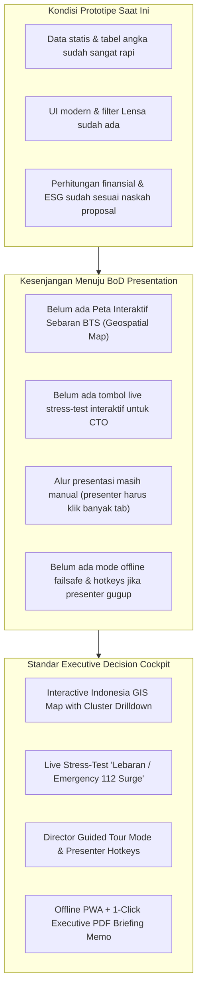

# 🏆 Master Plan: Elevasi Telkomsel ImpactGrid Menuju Presentasi Dewan Direksi (BoD) Telkomsel

> **Target Audiens:** Dewan Direksi (CEO, Direktur Network/CTO, Direktur Finance/CFO, Direktur Planning/Transformation) PT Telekomunikasi Selular (Telkomsel)  
> **Konteks:** Final / Grand Final & Eksekutif Showcase — *TDC Summit Fest (TSF) 2026*  
> **Fokus Utama:** Mengubah prototipe teknis menjadi **Enterprise Executive Decision Cockpit** yang kredibel, tahan banting, dan membuktikan kelayakan bisnis miliaran rupiah tanpa mengorbankan SLA jaringan.

---

## 🎯 1. Matriks Kebutuhan & Ekspektasi Dewan Direksi (BoD Persona)

Setiap direktur Telkomsel memiliki lensa dan kekhawatiran yang sangat spesifik. Prototipe web harus mampu menjawab pertanyaan batin mereka dalam **30 detik pertama**:

| Figur Direksi | Fokus Utama & "Ketakutan Terbesar" | Fitur Web yang Harus Membuktikan | Indikator Keberhasilan (Proof Point) |
|---|---|---|---|
| **Direktur Network / CTO** | • **Risiko Outage & Drop Call** • Vendor Lock-in (Ericsson, Huawei, ZTE, Nokia) • Panggilan Darurat 112 & VVIP terganggu | • **Multi-Layer Safety Guardrails** • **Surge/Emergency Stress Test Button** • Vendor-Agnostic Telemetry Pipeline | Demo instan pemulihan daya (*wake-up latency* < 150ms) saat lonjakan trafik simulasi (misal: Lebaran / Bencana). |
| **Direktur Keuangan / CFO** | • **CapEx bengkak tanpa hasil** • Angka penghematan terlalu optimistis (*hollow claim*) • Cash flow terganggu | • **Self-Funding Reinvestment Model** • Dynamic Sensitivity Analysis (Tarif PLN, Inflasi) • Transparansi Tabel CapEx/OpEx (Tabel 5 & 6) | Bukti *Payback Period* 1,0–1,9 tahun dan penghematan OpEx Rp21,9 Miliar/tahun yang mendanai fase berikutnya secara mandiri. |
| **Direktur Strategy & Sustainability (ESG)** | • **Tuduhan Greenwashing** • Regulasi OJK POJK 51 & Bursa Efek Indonesia (BEI) • Defisit dekarbonisasi 547.000 ton CO2e | • **MRV Audit Trail terenkripsi SHA-256** • Metodologi Standar ITU-T L.1331 (40 Uji vs 10 Kontrol) • Ekspor Sertifikat Verifikasi Emisi | Data penurunan emisi riil yang telah memisahkan anomali cuaca & kenaikan payload data. |
| **Direktur Utama / CEO** | • **Eksekusi lambat & resistensi operasional** • Dampak ke citra Telkomsel sebagai Green Telco Leader • Skalabilitas nasional (293.000+ BTS) | • **Executive 1-Page Summary** • **Peta Interaktif Nasional (Geospatial View)** • Roadmap Eksekusi 3 Horizon (2027–2031) | Kejelasan visi bahwa sistem ini siap diuji di lapangan (*ready-to-pilot*) dalam 9 bulan pertama 2027. |

---

## 🔍 2. Gap Analysis: Kondisi Saat Ini vs Standar Board-of-Directors

---

## 🚀 3. Rencana Aksi Pengembangan (Action Plan 4 Fase)

### 📌 FASE 1: High-Impact Visuals & Peta Geospasial Indonesia (Hari 1–2)
*Tujuan: Memberikan 'visual hook' langsung di 10 detik pertama pembukaan presentasi.*

1. **Peta Interaktif Sebaran BTS (Indonesia GIS Map Component):**
   - Menambahkan peta interaktif kluster regional Telkomsel (Jabodetabek, Jabar, Jatim-Bali-Nusra, Sumatera, Kalimantan, Sulampua).
   - Indikator status per kluster: Hijau (Hemat Optimal), Biru (Siaga Trafik), Amber (Pemeliharaan).
   - Fitur klik pada kluster untuk memunculkan detail popover: Jumlah BTS aktif, konsumsi MW harian, dan penghematan terakumulasi.
2. **Director Perspective Filter Enhancement:**
   - Menyempurnakan filter lensa di Navbar (`CEO`, `Network/CTO`, `Finance/CFO`, `ESG Leader`).
   - Ketika dipilih, kartu KPI yang paling relevan untuk direktur tersebut otomatis mendapatkan sorotan (*glow border & auto-focus*).

---

### 📌 FASE 2: CTO Wow-Factor — "Live Stress-Test & 112 Guardrail" (Hari 2–3)
*Tujuan: Menghilangkan keraguan Direktur Network soal risiko jaringan terganggu.*

1. **Tombol "Simulasi Lonjakan Trafik Ekstrem (Lebaran / Bencana)" di Tab Optimasi/Overview:**
   - Saat presenter menekan tombol ini:
     - Grafik profil beban daya langsung melonjak ke kapasitas 100%.
     - Mode *sleep* AI otomatis dinonaktifkan dalam hitungan milidetik (*Wake-up Latency: 120ms*).
     - Banner indikator proteksi menyala hijau terang: *"Panggilan Darurat 112 & Kanal VVIP Diproteksi Penuh — Zero Drop Call"*.
   - Ini adalah senjata pamungkas untuk memukau CTO bahwa sistem ini memiliki insting keamanan kelas operator telekomunikasi tier-1.
2. **Visualisasi Kurva Pareto Frontier Interaktif:**
   - Slider yang memungkinkan direktur melihat titik keseimbangan optimal antara **Efisiensi Energi (%) vs Latency Delta (ms)**.

---

### 📌 FASE 3: CFO Financial Rigor & Sensitivity Sandbox (Hari 3–4)
*Tujuan: Membuktikan bahwa kalkulasi finansial bukan angka di atas kertas, melainkan model dinamis yang tahan uji.*

1. **Dynamic Sensitivity Controls di Tab Finansial:**
   - Slider Penyesuaian Tarif Listrik PLN (Rp1.300 – Rp1.800 / kWh).
   - Slider Tingkat Inflasi & Suku Bunga Diskonto WACC (8% – 12%).
   - Tampilan *Live Real-Time Update* pada angka **NPV 5 Tahun** dan **Payback Period**.
2. **Visualisasi Self-Funding Reinvestment Loop (Siklus Swadana):**
   - Diagram aliran kas interaktif yang memperlihatkan bagaimana Rp300 Juta penghematan fase Pilot membiayai monitoring fase Regional, dan Rp6,6 Miliar fase Regional membiayai CapEx ekspansi Nasional tanpa menyedot anggaran baru dari kas korporat.

---

### 📌 FASE 4: Enterprise Hardening & Demo Presentation Tooling (Hari 4–5)
*Tujuan: Memastikan demo berjalan 100% mulus tanpa kendala teknis sekecil apa pun.*

1. **Director Presentation Mode (Guided Tour Walkthrough):**
   - Tombol *"Mode Presentasi Direksi"* di header.
   - Menyediakan navigasi berbasis langkah (Langkah 1: Masalah Emisi ➡️ Langkah 2: Solusi AI ➡️ Langkah 3: Bukti Finansial ➡️ Langkah 4: Kepatuhan ESG) lengkap dengan *bullet points* narasi pembicara.
2. **Hotkeys Presenter Cepat:**
   - Tombol keyboard `1` - `6` untuk pindah tab secara instan.
   - Tombol `S` untuk memicu simulasi lonjakan darurat.
   - Tombol `F` untuk fullscreen.
3. **PWA / Zero-Dependency Offline Caching:**
   - Menjamin aplikasi tetap berjalan 60 FPS tanpa jeda bahkan jika koneksi internet di ruang rapat/hall mendadak putus.
4. **1-Click Executive Board Memo (Print/PDF Ready):**
   - Menghasilkan dokumen ringkasan eksekutif 2 halaman bergaya memo resmi Telkomsel yang bisa langsung dicetak atau dibagikan ke para direktur.

---

## 🎤 4. Skrip Presentasi Eksekutif 3 Menit (Elevator Pitch BoD)

Gunakan struktur narasi **"Why, How, What, Bottom-Line"**:

* **Menit 0:00 – 0:45 (The Paradox / Why):**
  > *"Bapak/Ibu Direksi yang kami hormati, konsumsi listrik 293.000 BTS menyumbang lebih dari 63% beban emisi Scope 2 Telkomsel dengan biaya energi triliunan rupiah per tahun. Kita menghadapi paradoks: efisiensi data per Terabyte membaik, namun emisi absolut tetap naik seiring ledakan trafik 5G. ImpactGrid hadir bukan sekadar mematikan perangkat, melainkan sistem orkestrasi otonom berbasis AI yang mengoptimasi konsumsi daya tanpa menyentuh SLA mutu jaringan."*
* **Menit 0:45 – 1:30 (Live Prototype Proof / How):**
  > *(Buka Peta & Tab Optimasi)* *"Inilah ImpactGrid Control Tower. Mengintegrasikan telemetri multi-vendor Ericsson, Huawei, ZTE, Nokia dengan smart meter PLN. Mari kita uji skenario darurat: jika terjadi lonjakan trafik tiba-tiba di Jabodetabek..."* *(Klik tombol Surge)* *"...dalam 120 milidetik sistem otomatis mengembalikan seluruh kapasitas, mengamankan panggilan darurat 112, dan menjaga zero outage."*
* **Menit 1:30 – 2:15 (The Financial Return / Bottom-Line):**
  > *(Buka Tab Finansial)* *"Bagi keuangan perusahaan, sistem ini bersifat Self-Funding. Pada tahap pilot 40 lokasi, kita membuktikan penghematan Rp300 juta dengan payback 1,9 tahun. Penghematan ini kemudian mendanai fase regional 5.000 BTS hingga menghasilkan NPV 5 tahun sebesar Rp41,48 Miliar pada skala nasional."*
* **Menit 2:15 – 3:00 (ESG & Closing / What Next):**
  > *(Buka Tab ESG & Tunjukkan Laporan MRV)* *"Klaim dekarbonisasi 12.700 ton CO2e terverifikasi dengan standar ITU-T L.1331 anti-greenwashing yang siap diaudit untuk pelaporan IDX ESG dan POJK 51. Tim AWAKENING Reborn siap mengawal uji coba lapangan 9 bulan pertama 2027. Terima kasih."*

---

## 🛡️ 5. Matriks Pertanyaan Kritis Direksi & Jawaban Terkalibrasi

| Pertanyaan Kemungkinan dari Direksi | Siapa yang Menanyakan | Jawaban Strategis Berbasis Web |
|---|---|---|
| *"Bagaimana jika AI salah memprediksi dan BTS mati saat ada event besar seperti konser atau Lebaran?"* | Direktur Network / CTO | **Tunjukkan Guardrail di Web:** *"ImpactGrid memiliki arsitektur 3-lapis pengaman: deteksi gradien trafik real-time, bypass otomatis 112, dan mode fail-safe yang langsung mematikan sleep mode jika trafik menyentuh ambang 65% kapasitas."* |
| *"Apakah vendor RAN (Ericsson, Huawei, ZTE) akan mengizinkan sistem kita mengontrol sleep mode mereka?"* | CTO / VP Network Architecture | **Jawab dengan Arsitektur O-RAN:** *"ImpactGrid dirancang vendor-agnostic melalui antarmuka standar 3GPP Rel-18 dan O-RAN Non-Real-Time RIC (RAN Intelligent Controller) via protokol standard Netconf/YANG, sehingga tidak merusak garansi vendor."* |
| *"Angka penghematan 10% ini apakah realistis atau hanya simulasi komputer?"* | Direktur Keuangan / CFO | **Tunjukkan Metodologi 40 vs 10 Kontrol:** *"Angka ini berbasis studi literatur aktual GSMA dan ITU-T L.1331. Di web ini, kami bahkan membandingkan 40 lokasi intervensi dengan 10 lokasi kontrol pembanding untuk memisahkan efek cuaca dan trafik."* |
| *"Berapa lama waktu yang dibutuhkan dari prototipe ini sampai benar-benar online di BTS Telkomsel?"* | Direktur Utama / CEO | **Tunjukkan Roadmap 3 Horizon:** *"Fase 1 (Pilot 40 Sites) dirancang selama 9 bulan di tahun 2027 menggunakan infrastruktur cloud dan smart meter PLN yang sudah ada, tanpa perlu modifikasi perangkat keras besar."* |

---

## 📋 6. Checklist Eksekusi Pra-Presentasi (Zero-Error Protocol)

- [ ] Resolusi layar diuji pada 1080p, 2K, dan 4K projector.
- [ ] Font & kontras warna memenuhi standar kenyamanan baca jarak 3–5 meter.
- [ ] Service worker / LocalStorage caching aktif agar web bisa dijalankan secara offline (`npm run preview` atau build statis).
- [ ] Shortcut keyboard diuji (1, 2, 3, 4, 5, S untuk stress test).
- [ ] Modal cetak laporan eksekutif teruji rapi tanpa potongan halaman yang janggal.
- [ ] Skrip narasi 3 menit dilatih dengan stopwatch (maksimal 2 menit 45 detik agar ada sisa waktu untuk impresi awal).
