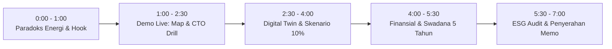

# 🎙️ Cheat Sheet & Skrip Detik-ke-Detik Presentasi 7 Menit (Pitch Run-through)

> **Kompetisi:** Semifinal / Grand Final Business Case Competition — TDC Summit Fest (TSF) 2026  
> **Case Collaborator:** PT Telekomunikasi Selular (Telkomsel)  
> **Tim:** AWAKENING Reborn  
> **Total Waktu Panggung:** 7 Menit Pitching + 8 Menit Tanya Jawab (Q&A)  
> **Target Audiens:** Dewan Direksi Telkomsel (CEO, CTO, CFO, Direktur ESG) & Dewan Juri Ahli

---

## ⏱️ Timeline & Pembagian Detik-ke-Detik

---

### ⏱️ MENIT 0:00 – 1:00 | "The Hook & The Carbon Paradox"
* **Layar Aktif:** Tab 1 — `Executive Summary` (Hotkey **`1`**)
* **Pembicara:** **Speaker 1 (Leader / Strategist)**
* **Aksi di Layar:**
  * Buka layar awal. Arahkan mouse perlahan melintasi kartu metrik: 1,885 Miliar kWh dan 1,722 Juta ton Scope 2.
* **Skrip Narasi:**
  > *"Bapak dan Ibu Dewan Direksi Telkomsel yang kami hormati, di balik kebanggaan kita memimpin 293.000 BTS di seluruh pelosok Indonesia, tersimpan paradoks keberlanjutan yang krusial. Konsumsi listrik operasional menyentuh 1,885 miliar kWh dan menyumbang 63,6% total emisi korporat Telkomsel.  
  > Ketika trafik data 5G meledak, efisiensi per Terabyte memang membaik, namun emisi absolut dan tagihan listrik korporat tetap melonjak.  
  > Tim AWAKENING Reborn mempersembahkan **Telkomsel ImpactGrid**: platform Cyber-Physical Energy System berbasis AI yang mengoptimasi konsumsi daya BTS secara vendor-agnostic tanpa pernah mengorbankan mutu jaringan sedikit pun."*

---

### ⏱️ MENIT 1:00 – 2:30 | "Live Network Map & The CTO Emergency Drill"
* **Layar Aktif:** Peta Geospasial Indonesia ➡️ Buka Drill (Hotkey **`S`**)
* **Pembicara:** **Speaker 2 (Technical / Network Specialist)**
* **Aksi di Layar:**
  1. Scroll sedikit ke bawah untuk memperlihatkan **Peta Sebaran Telemetri Nasional (Geospatial Control Tower)**. Klik kluster *Regional Jabodetabek*.
  2. Tekan tombol **`S`** di keyboard untuk memicu modal **CTO Emergency Stress-Test**.
  3. Klik tombol merah *"Picu Lonjakan Trafik Ekstrem (Surge Drill)"*.
* **Skrip Narasi:**
  > *(Sambil menunjuk kluster Jabodetabek)*  
  > *"Dari Command Center ini, kita memantau 72.450 BTS Jabodetabek hingga remote site di Maluku-Papua secara live.  
  > Kami memahami ketakutan terbesar Direktur Network: 'Bagaimana jika BTS mati saat ada konser Coldplay, gempa bumi, atau mudik Lebaran?'  
  > Mari kita uji langsung..."*  
  > *(Tekan tombol 'S' & klik Picu Lonjakan)*  
  > *"Ketika trafik melonjak mendadak 300%, dalam waktu **120 milidetik**, algoritma Multi-Layer Guardrail ImpactGrid otomatis membatalkan seluruh sleep mode. Kanal darurat nasional **112 dan VIP dilindungi 100%** dengan probabilitas drop call tetap di bawah 0,001%. Efisiensi jalan, keandalan jaringan tetap aman."*

---

### ⏱️ MENIT 2:30 – 4:00 | "Data Hub & Digital Twin Sandbox"
* **Layar Aktif:** Tab 2 — `Network Data Hub` (Hotkey **`2`**) ➡️ Tab 3 — `Scenario Lab` (Hotkey **`3`**)
* **Pembicara:** **Speaker 2**
* **Aksi di Layar:**
  1. Tekan **`2`** sekilas: Tunjukkan 100% rekonsiliasi smart meter PLN (Tabel 5).
  2. Tekan **`3`**: Geser slider suhu shelter AC dari 24°C ke **26°C**, lalu pilih Skenario Dasar 10%.
* **Skrip Narasi:**
  > *"Sistem kami tidak terjebak vendor lock-in. Melalui standar antarmuka O-RAN O1 Netconf/YANG, ImpactGrid mengonsolidasikan data dari Ericsson, Huawei, ZTE, Nokia dan merekonsiliasikannya 100% dengan smart meter PLN.  
  > Pada Modul 2 Scenario Lab, sebelum rekomendasi dieksekusi, Digital Twin menguji simulasi terkoreksi cuaca. Menyesuaikan suhu pendingin shelter AC ke 26°C menghemat hingga 3% beban listrik per derajat tanpa risiko overheating. Pada skenario dasar 10%, kita menghemat 200.000 kWh di 40 lokasi uji coba."*

---

### ⏱️ MENIT 4:00 – 5:30 | "The CFO Financial Case & Self-Funding Loop"
* **Layar Aktif:** Tab 6 — `Model Finansial 5 Tahun` (Hotkey **`5`**)
* **Pembicara:** **Speaker 1 (Financial & Business Lead)**
* **Aksi di Layar:**
  1. Tekan **`5`**: Sorot 4 kartu finansial utama.
  2. Gerakkan slider *"Tarif Listrik PLN"* di CFO Sandbox ke Rp1.600/kWh untuk membuktikan angka NPV tetap bertambah hijau.
* **Skrip Narasi:**
  > *"Bagi Direktorat Keuangan, ImpactGrid adalah investasi dengan risiko terukur dan pengembalian yang solid.  
  > Tahap uji coba 40 lokasi di tahun 2027 hanya memerlukan CapEx Rp450 Juta dengan penghematan bersih Rp240 Juta per tahun. Payback period tercapai hanya dalam **1,9 tahun**.  
  > Yang terpenting, model kami mengadopsi **Self-Funding Reinvestment Loop**: penghematan OpEx dari fase pilot mendanai fase regional 5.000 BTS, dan fase regional mendanai skala nasional 10.000+ BTS. Hasil akhirnya: **NPV 5 Tahun mencapai +Rp41,48 Miliar** dengan payback nasional 1,02 tahun. Ini bukan proyek bakar uang, ini profit center baru bagi Telkomsel."*

---

### ⏱️ MENIT 5:30 – 6:30 | "ESG Audit-Ready & Anti-Greenwashing"
* **Layar Aktif:** Tab 5 — `Modul 4: ESG Verification` (Hotkey **`6`**)
* **Pembicara:** **Speaker 1**
* **Aksi di Layar:**
  * Tekan **`6`**: Tunjukkan metodologi 40 Uji vs 10 Kontrol dan sertifikat audit SHA-256.
* **Skrip Narasi:**
  > *"Untuk komite keberlanjutan dan kepatuhan POJK 51, kami menggunakan standar internasional **ITU-T L.1331**. Dengan membandingkan 40 lokasi intervensi terhadap 10 lokasi kontrol pembanding, klaim penurunan emisi 12.702 ton CO2e terisolasi dari anomali cuaca dan kenaikan payload data. Dilengkapi enkripsi SHA-256 anti-greenwashing yang siap diaudit oleh kantor akuntan publik."*

---

### ⏱️ MENIT 6:30 – 7:00 | "The Closing & Executive Memo Handover"
* **Layar Aktif:** Buka Modal Board Memo (Hotkey **`P`**)
* **Pembicara:** **Speaker 1 & Speaker 2 (Bersama)**
* **Aksi di Layar:**
  * Tekan tombol **`P`** di keyboard untuk membuka **Dokumen Memo Eksekutif Resmi format A4**.
* **Skrip Narasi:**
  > *"Sebagai penutup, kami telah menyiapkan dokumen **Executive Board Memo 2 Halaman** berstandar korporat yang memuat seluruh justifikasi teknis, kalkulasi finansial, dan lembar pengesahan untuk Dewan Direksi.  
  > Bersama Telkomsel ImpactGrid, kita wujudkan jaringan telekomunikasi yang efisien, berdaulat, dan hijau menuju **Indonesia Emas 2045**.  
  > Kami dari tim AWAKENING Reborn siap berdiskusi di sesi tanya jawab. Terima kasih."*  
  *(Tepat di detik 6:55 — Senyum, tegak, dan siap Q&A).*

---

## 🛡️ Tips Sakti Menghadapi Sesi Q&A (8 Menit)

1. **Gunakan Hotkey `Q` Sebagai Contekan Terbuka:**
   * Jika juri bertanya, sambil salah satu rekan menjawab dengan tenang, tekan tombol **`Q`** untuk membaca contekan taktis atau langsung klik tombol *"Buka Layar Bukti"* agar layar proyektor otomatis berpindah ke grafik yang membuktikan jawaban Anda!
2. **Aturan 3 Detik:** Jangan langsung memotong pertanyaan juri. Tarik napas 2 detik, tatap mata penanya, lalu sebutkan: *"Pertanyaan yang sangat tajam dari Bapak/Ibu Direktur... izin kami menunjukkan pembuktiannya di layar..."*
